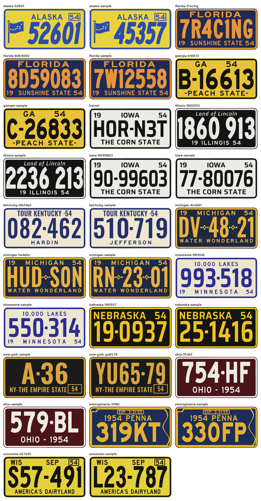

# Printed reg plates

3D-printable 1950s US licence plates for model cars. Each state has a template copied from a real 1954 plate: its own layout, lettering, colours and serial format. You get random serials in the real format, or your own text, raised on a plate blank STL.



## States

All templates are from 1954 plates (photo links are in each template's `photo` field, from Wikipedia's *Vehicle registration plates of the United States for 1954*).

| Template | Layout | Serial format | Colours |
|---|---|---|---|
| `iowa` | 19 IOWA 54 / serial / THE CORN STATE | `77-80076` | black on white |
| `michigan` | 19 MICHIGAN 54 / serial with crosses / WATER WONDERLAND | `RN-23-01` | yellow on dark blue |
| `nebraska` | big NEBRASKA 54 / serial | `25-1416` | yellow on black |
| `pennsylvania` | EXP box, 1954 PENNA / serial, state-shaped border | `330FP` | yellow on blue |
| `florida` | FLORIDA / serial / 19 SUNSHINE STATE 54 | `7W12558` | orange on blue |
| `illinois` | italic Land of Lincoln / serial / 19 ILLINOIS 54 | `2236 213` | white on black |
| `new-york` | serial / NY-THE EMPIRE STATE + 54 tab | `AB12-34` | gold on black |
| `minnesota` | 10,000 LAKES / serial / 19 MINNESOTA 54 | `550-314` | blue on cream |
| `georgia` | GA 54 / serial / -PEACH STATE- | `C-26833` | black on yellow |
| `ohio` | serial / OHIO - 1954 | `579-BL` | white on maroon |
| `wisconsin` | WIS, SEP, 54 tab / serial / AMERICA'S DAIRYLAND | `L23-787` | black on yellow |
| `kentucky` | TOUR KENTUCKY ·54 / serial / county name | `510-719` | blue on cream |
| `alaska` | flag, ALASKA, 54 tab / slanted serial | `45357` | blue on yellow |

In a serial, `-` is the state's own separator (dot, dash, round dot or Michigan's cross) and a space is a gap.

## Build

```sh
python3 -m venv .venv && source .venv/bin/activate
pip install -r requirements.txt

python src/build_all.py                  # every plate in plates/ + output/overview.png
python src/build_all.py hornet           # just one
```

Each plate gets `output/<name>/` with `face.svg` (exact size, text as outlines), `plate.stl`, `text_only.stl` and `topview.png` (a render of the STL).

## Make plates

```sh
python src/generate.py michigan -n 5                 # 5 random Michigan plates
python src/generate.py all -n 2                      # 2 random plates for every state
python src/generate.py iowa --serial H0R-N3T --name hornet
python src/generate.py iowa --serial H0R-N3T --set year_right=51
python src/generate.py kentucky --serial 510-719 --set county=FAYETTE
```

`generate.py` writes small configs to `plates/`; build them with `build_all.py`. A plate config looks like:

```json
{ "name": "hornet", "template": "iowa", "serial": "H0R-N3T", "text": { "slogan": "THE CORN STATE" } }
```

`text` overrides any template element by its `id` (`state`, `slogan`, `year_left`, `year_right`, `county`, …). Leave `serial` as `null` to use the template's example serial.

Long serials are squeezed first and then shrunk to fit, so custom text always stays inside the rim.

## Add a state

Copy a template in `templates/` and edit its elements. Positions are fractions of the face (the area inside the blank's rim): `x` of the width, `baseline` of the height from the top, `cap` = letter height as a fraction of the face height.

| Element | Fields |
|---|---|
| `text` | `text`, `font`, `cap`, `baseline`, `x`, `anchor` (start/middle/end), `width` + `fit` (spread / `scale` / `max`), `track`, `sx`, `skew`, `stem` |
| `serial` | `font`, `cap`, `baseline`, `x0`, `x1`, `sep` (dot/rdot/dash/cross/none), `stem`, `skew`, `min_sx`, `max_sx`, `gap`, `sep_pad` |
| `box` | `x0`, `y0`, `x1`, `y1`, `stroke`, `radius` (year tabs) |
| `shape` | `alaska_flag` or `pa_border` |

`stem` thickens strokes to that fraction of the letter height, to match heavy stamped dies. `serial_format` uses `9` for a digit and `L` for a letter (I, O and Q are never picked).

## Fonts

The real plates were stamped with each state's own dies; no free fonts copy them, so each template uses the closest of these, tuned for width and weight:

- **Saira** (Condensed, Semi Condensed, SemiBold, Italic): squared-off O and 0. SIL Open Font License.
- **Oswald**: tall, narrow, straight-sided O. SIL Open Font License.
- **Highway Gothic** C, D, E, EM (Roadgeek 2014): the 1950s US road-sign lettering, round shapes. MIT licence.

Licence files are in `fonts/`. Variable fonts were turned into static instances with overlapping contours removed, so they extrude cleanly.

## Blank

`blanks/Licence_Plate.stl` is 37.5 × 18.8 × 4 mm with a face at z 3.7 and a 0.3 mm raised rim; `blanks/Licence_Plate.json` holds its measurements. For a different blank run `python src/measure_blank.py blanks/<file>.stl > blanks/<file>.json` and point a plate at it with `"blank": "blanks/<file>.json"`.

## Printing

- Text, separators, tabs and artwork are raised 0.3 mm, level with the blank's rim.
- Smallest text: Pennsylvania's EXP. 3-31-55 is about 1.3 mm tall, and the other small lines are 1.6–3.3 mm. Use a 0.2 mm nozzle, or check those lines in the slicer preview.
- Alaska's flag stars are about 0.6 mm holes; they may close up on a 0.4 mm nozzle. Set `"stars": false` in the template to leave them out.
- Two colours: pause at 3.7 mm and swap filament, or load `text_only.stl` as a second part of the same object.
- The blank mesh isn't closed, so `plate.stl` holds the blank and the raised parts as separate overlapping bodies. PrusaSlicer, Bambu Studio and Cura merge them when loaded as one object.
