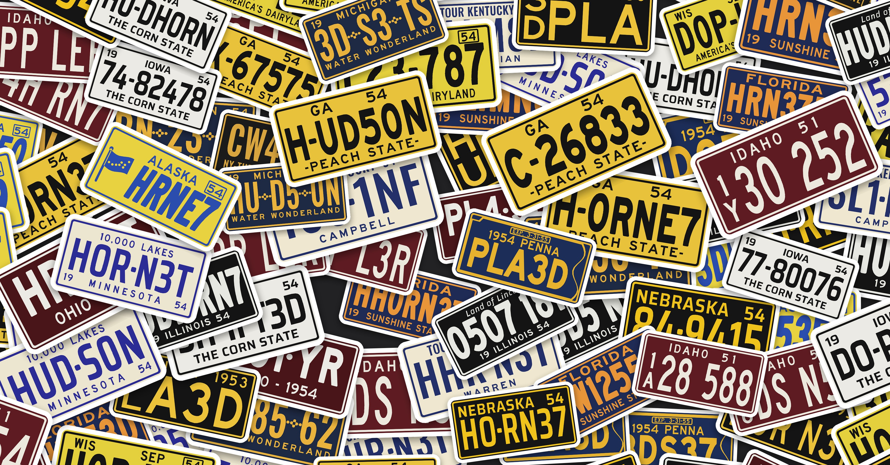

# Printed reg plates

3D-printable 1950s US licence plates for model cars. Each state has a template copied from a real 1954 plate: its own layout, lettering, colours and serial format. You get random serials in the real format, or your own text, raised on a plate blank STL.



## States

Most templates are from 1954 plates; Idaho is the 1951 plate and Utah the 1953 one, both still within the Hudson Hornet's 1951–57 run. Photo links are in each template's `photo` field (Wikimedia Commons).

| Template | Layout | Serial format | Colours |
|---|---|---|---|
| `iowa` | 19 IOWA 54 / serial / THE CORN STATE | `77-80076` | black on white |
| `michigan` | 19 MICHIGAN 54 / serial with crosses / WATER WONDERLAND | `RN-23-01` | yellow on dark blue |
| `nebraska` | big NEBRASKA 54 / serial | `25-1416` | yellow on black |
| `pennsylvania` | EXP box, 1954 PENNA / serial, state-shaped border | `330FP` | yellow on blue |
| `florida` | FLORIDA / serial / 19 SUNSHINE STATE 54 | `7W12558` | orange on blue |
| `illinois` | italic Land of Lincoln / serial / 19 ILLINOIS 54 | `2236 213` | white on black |
| `new-york` | serial / NY-THE EMPIRE STATE + 54 tab | `AB12-34` | gold on black |
| `minnesota` | 10,000 LAKES / serial / 19 MINNESOTA 54 | `550-314` | blue on cream |
| `georgia` | GA 54 / serial / -PEACH STATE- | `C-26833` | black on yellow |
| `ohio` | serial / OHIO - 1954 | `579-BL` | white on maroon |
| `wisconsin` | WIS, SEP, 54 tab / serial / AMERICA'S DAIRYLAND | `L23-787` | black on yellow |
| `kentucky` | TOUR KENTUCKY ·54 / serial / county name | `510-719` | blue on cream |
| `alaska` | flag, ALASKA, 54 tab / slanted serial | `45357` | blue on yellow |
| `idaho` | IDAHO 51 / stacked county code + serial (1951–52 plate) | `1/A 28 588` | white on maroon |
| `utah` | UTAH 1953 / stacked letters + serial (1953 plate) | `B/H 980` | yellow on black |

In a serial, `-` is the state's own separator (dot, dash, round dot or Michigan's cross) and a space is a gap. A prefix like `1/A ` is stacked, 1 over A, in small characters left of the serial (Idaho's county code, Utah's letters); a serial without one starts at the left edge instead.

## Per-state folders

Everything to print is in `output/states/<state>/`:

| File | What it is |
|---|---|
| `<state>-vanity.jpg` | preview: the real 1954 example, your own plates and every vanity serial for the state |
| `<state>-random.jpg` | preview: 50 random serials in the state's real format |
| `stl/<state>-<series>-<serial>.stl` | one STL per plate (blank + raised text) |
| `3mf/<state>-BambuOrca.3mf` | every plate of the state for Bambu Studio / OrcaSlicer: Bambu Lab P1S with AMS, 45 per plate, several plates |
| `3mf/<state>-PrusaSlicer.3mf` | the same for PrusaSlicer 2.9: Original Prusa MK4S MMU3, 30 per bed, several beds in one project |
| `plates.json` | the list: series (sample, custom, vanity, random), serial, Kentucky county |

```sh
python src/vanity.py --random 50 --no-sheets   # 1. serial lists from vanity_keywords.json + 50 random per state
python src/build_states.py                    # 2. previews, STLs and 3MFs for every state (a few minutes)
python src/sticker_bomb.py                    # 3. output/previews/sticker-bomb-*.jpg
```

`build_states.py --states iowa utah` rebuilds only some states; `--skip-stl` / `--skip-3mf` / `--skip-previews` skip parts. Personal plates are listed under `"personal"` in `custom_plates.json` (H0R-N3T on Iowa, Idaho and Utah).

### Colours and the filament change in the 3MFs

Both projects have two filaments: 1 is the state's background colour, 2 its ink colour. Every plate starts on filament 1, and a filament change to 2 is set at the first layer above the face of the blank (z 3.7), so the rim and text print in the ink colour. With an AMS or MMU3 the change is automatic.

- **Bambu Studio / OrcaSlicer** (`*-BambuOrca.3mf`): printer, process and filament settings come from Martin's own saved P1S project (`slicer_refs/orca_p1s_0.2_project_settings.json`): Bambu Lab P1S, 0.2 nozzle, 0.10 mm Standard (0.1 mm first layer). Change at z 3.8. The back of each plate is kept free for the prime tower.
- **PrusaSlicer 2.9** (`*-PrusaSlicer.3mf`): Original Prusa MK4S MMU3, 0.4 nozzle, 0.10 mm FAST DETAIL with a 0.2 mm first layer, Prusament PLA (`slicer_refs/prusa_mk4s_mmu3_0.10.ini`). Change at z 3.8. The wipe tower sits at the back left (x 15, y 165), clear of the plates.
- To use other settings, save a project from your slicer and replace the file in `slicer_refs/`; the change height follows its layer heights (the face must end on a layer).
- The STLs and 3MFs are regenerated by `build_states.py` and are not committed.

### Sticker bomb previews

`src/sticker_bomb.py` mixes plates from every state into two collages in `output/previews/`: `sticker-bomb-facebook.jpg` (3600 × 1885, 1.91:1) and `sticker-bomb-printables-3x4.jpg` (2400 × 3200, 3:4).

## Build

```sh
python3 -m venv .venv && source .venv/bin/activate
pip install -r requirements.txt

python src/build_all.py                  # every plate in plates/
python src/build_all.py hornet           # just one
python src/build_all.py --series custom  # one series: sample, custom or random
```

Overview sheets: `output/overview.png` (the 15 state samples) and `output/overview-<series>.png` for each series.

Each plate gets `output/<name>/` with `face.svg` (exact size, text as outlines), `plate.stl`, `text_only.stl` and `topview.png` (a render of the STL).

## Make plates

```sh
python src/generate.py michigan -n 5                 # 5 random Michigan plates
python src/generate.py all -n 2                      # 2 random plates for every state
python src/generate.py iowa --serial H0R-N3T --name hornet
python src/generate.py iowa --serial H0R-N3T --set year_right=51
python src/generate.py kentucky --serial 510-719 --set county=FAYETTE
python src/generate.py idaho --serial "1/A H0R N3T" --name idaho-hornet
```

### Custom plates

`custom_plates.json` lists vanity serials per state around Hudson, the Hornet, 3D Sets, Doppler, Eliminator, Shifted and 3D printing (PLA, PETG, infill, nozzle, G28…). Each one keeps its state's grouping, e.g. Michigan `HU-DS-0N`, Illinois `HRNT 308`, Pennsylvania `308HH`, Utah `H/H 308`. Edit the list and run:

```sh
python src/generate.py --list custom_plates.json
python src/build_all.py --series custom
```

`generate.py` writes small configs to `plates/`; build them with `build_all.py`. A plate config looks like:

```json
{ "name": "hornet", "template": "iowa", "series": "custom", "serial": "H0R-N3T", "text": { "slogan": "THE CORN STATE" } }
```

`series` groups plates: `sample` (the real 1954 example), `custom` (your own text) or `random`. `text` overrides any template element by its `id` (`state`, `slogan`, `year_left`, `year_right`, `county`, …). Leave `serial` as `null` to use the template's example serial.

Long serials are squeezed first and then shrunk to fit, so custom text always stays inside the rim.

### Vanity and random plates

`src/vanity.py` turns the keywords in `vanity_keywords.json` (Hudson, Hornet, Doppler, 3D Sets, Eliminator, Infill, Shifted, Racing, NASCAR, PLA, each with a few shortened spellings) into vanity serials. Every serial has at least one letter-to-number swap (O=0, E=3, A=4, I=1, S=5, T=7, G=6, B=8), because a plate can't be all letters. A serial goes to a state only if it has exactly as many characters as that state's format, and is laid out in that state's grouping; the rest is skipped.

```sh
python src/vanity.py --random 24         # vanity_plates.json + random_plates.json and the sheets
python src/vanity.py --states utah iowa  # only some states
```

- `output/vanity/<state>-01.jpg`: the vanity serials for that state, most readable first (fewer swaps, full spelling before shortened).
- `output/random/<state>.jpg`: random serials in the state's real format (not checked against real county codes).

These are previews only (no STL). Copy the ones you like into `custom_plates.json` and build them as custom plates. The two output folders are not committed; regenerate them any time.

NASCAR is a registered trademark; fine on your own model, but leave it off plates you publish.

## Add a state

Copy a template in `templates/` and edit its elements. Positions are fractions of the face (the area inside the blank's rim): `x` of the width, `baseline` of the height from the top, `cap` = letter height as a fraction of the face height.

| Element | Fields |
|---|---|
| `text` | `text`, `font`, `cap`, `baseline`, `x`, `anchor` (start/middle/end), `width` + `fit` (spread / `scale` / `max`), `track`, `sx`, `skew`, `stem` |
| `serial` | `font`, `cap`, `baseline`, `x0`, `x1`, `sep` (dot/rdot/dash/cross/none), `stem`, `skew`, `min_sx`, `max_sx`, `gap`, `sep_pad`, `x0_plain` (start when there's no stacked prefix), `stack` (`x`, `cap`, `baselines` [top, bottom], `font`, `sx`, `stem`) |
| `box` | `x0`, `y0`, `x1`, `y1`, `stroke`, `radius` (year tabs) |
| `shape` | `alaska_flag` or `pa_border` |

`stem` thickens strokes to that fraction of the letter height, to match heavy stamped dies. `serial_format` uses `9` for a digit and `L` for a letter (I, O and Q are never picked).

## Fonts

The real plates were stamped with each state's own dies; no free fonts copy them, so each template uses the closest of these, tuned for width and weight:

- **Saira** (Condensed, Semi Condensed, SemiBold, Italic): squared-off O and 0. SIL Open Font License.
- **Oswald**: tall, narrow, straight-sided O. SIL Open Font License.
- **Highway Gothic** C, D, E, EM (Roadgeek 2014): the 1950s US road-sign lettering, round shapes. MIT licence.

Licence files are in `fonts/`. Variable fonts were turned into static instances with overlapping contours removed, so they extrude cleanly.

## Blank

`blanks/Licence_Plate.stl` is 37.5 × 18.8 × 4 mm with a face at z 3.7 and a 0.3 mm raised rim; `blanks/Licence_Plate.json` holds its measurements. For a different blank run `python src/measure_blank.py blanks/<file>.stl > blanks/<file>.json` and point a plate at it with `"blank": "blanks/<file>.json"`.

## Printing

- Text, separators, tabs and artwork are raised 0.3 mm, level with the blank's rim.
- Smallest text: Pennsylvania's EXP. 3-31-55 is about 1.3 mm tall, and the other small lines are 1.6–3.3 mm. Use a 0.2 mm nozzle, or check those lines in the slicer preview.
- Alaska's flag stars are about 0.6 mm holes; they may close up on a 0.4 mm nozzle. Set `"stars": false` in the template to leave them out.
- Two colours: pause at 3.7 mm and swap filament, or load `text_only.stl` as a second part of the same object.
- The blank mesh isn't closed, so `plate.stl` holds the blank and the raised parts as separate overlapping bodies. PrusaSlicer, Bambu Studio and Cura merge them when loaded as one object.
